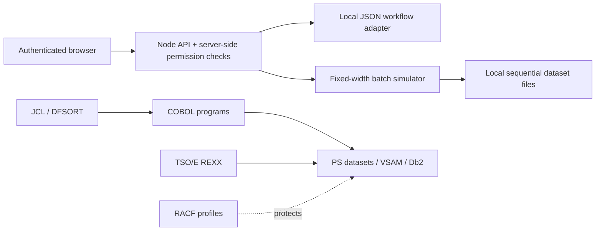

# Requirement Verification Matrix

Status describes the code in this repository. Mainframe target testing means compilation/submission against an authorized z/OS, Db2, VSAM, or RACF environment; no such environment was used for these checks.

| Requirement | Expected implementation | Relevant source files | Current status | Missing work | Verification method |
|---|---|---|---|---|---|
| Central RBAC | Server-derived roles, deny-by-default permission middleware and scope checks | `lib/auth.js`, `server.js`, `lib/workflow.js`, `auth-test.js` | Implemented and tested | Enterprise identity, durable/shared sessions, role lifecycle | Direct HTTP positive/negative tests for five roles |
| Demo login/session | Hashed local identities, secure cookie flags, expiry, logout, explicit bootstrap | `lib/auth.js`, `scripts/bootstrap-demo-users.js` | Implemented and tested | TLS setup, persistent session store, password reset/account lockout operations | HTTP login, forged-header, logout, and unauthorized tests |
| Role-aware dashboard | Backend aggregates scoped by actor role | `lib/workflow.js`, `public/index.html` | Implemented but not tested in the target environment | Browser automation/accessibility audit and date-period filters | HTTP response scope + browser JS syntax; manual browser acceptance still needed |
| 80-byte sequential dataset layout | Stable byte offsets, FB80 inputs/outputs, explicit malformed handling | `lib/pipeline.js`, `server.js`, `mainframe/EXPENSE-REC.cpy`, `data/EMPLOYEE.MASTER` | Implemented but not tested in the target environment | z/OS encoding/DCB validation; workflow-to-dataset category mapping | Node fixed-width tests; 80-byte sample length check |
| COBOL employee matching | Match transaction employee key to employee master; separate unknown employees | `mainframe/MATCH2.cbl`, `mainframe/EXPPIPE.jcl` | Partially implemented | Compile/runtime proof, indexed VSAM lookup is available as a separate path; pipeline still uses sequential master matching | Source review; compile and fixture execution on z/OS required |
| COBOL transaction validation | Validate numeric amount, category, actual calendar date; write good/reject records | `mainframe/EXPVALID.cbl`, `mainframe/EXPENSE-REC.cpy` | Implemented but not tested in the target environment | Shared category reference and target compiler/runtime proof | Node validation tests cover simulator only; COBOL compiler and test datasets required |
| COBOL count reconciliation | Compare input and output record totals and return RC 0/12 | `mainframe/CNTCHECK.cbl`, `mainframe/RPTCHECK.jcl` | Implemented but not tested in the target environment | Target compiler checks and JES return-code evidence | Count mismatch exercised in Node; compile and JES check required |
| COBOL posting/approval/report programs | Db2-aware posting, workflow eligibility, reports and rollback-safe transaction unit | `mainframe/db2/POSTEXP.sqc`, `mainframe/db2/POSTEXP.jcl` | Partially implemented | POSTEXP is an embedded-SQL posting example; approval/report COBOL programs and precompile/compile/bind/run proof remain absent | Source review; Db2 precompile and integration execution required |
| JCL staged batch | Allocate datasets, run sort/match/validate/report, conditionally check counts | `mainframe/EXPCLEAN.jcl`, `EXPPIPE.jcl`, `RPTCHECK.jcl`, `VSAM-DEFINE.jcl`, `VSAM-MATCH.jcl`, `db2/POSTEXP.jcl` | Partially implemented | Target syntax/JES checks, broader restart/error path, operational dataset retention procedures | Static review and IBM COND semantics; submit in disposable HLQ required |
| REXX TSO/E utility | Validate result records with bounded read-only automation and clear RCs; retain the separate dedupe/sort example | `mainframe/rexx/EXPMON.rexx`, `mainframe/jcl/EXPMON.jcl`, `mainframe/DEDUPSRT.rexx` | Implemented as a deployment wrapper; not target-executed | TSO/E syntax and JES execution evidence; scheduler/site library approval | Static source/JCL review; run EXPMON.jcl under TSO/E |
| Db2 relational schema | Employee/dept/category/expense/approval/batch/audit/reconciliation relations, keys and indexes | `mainframe/db2/01-schema.sql`, `03-workflow-schema.sql` | Partially implemented | Site schema/storage and SQL compatibility review, seed data, deployed test | DDL inspection; execute on target Db2 required |
| Db2 reports and safe posting | Search/report queries, duplicate-safe insert, SQLCODE/SQLSTATE, transaction boundaries | `mainframe/db2/02-report-queries.sql`, `POSTEXP.sqc`, `POSTEXP.jcl` | Partially implemented | More embedded program tests, precompiler/plan binding and target SQL validation | Source review; Db2 precompile, bind and run tests required |
| VSAM employee/reference KSDS | Keyed employee lookup, record layout aligned with key bytes 21-28 | `mainframe/VSAM-DEFINE.jcl`, `VSAM-MATCH.jcl`, `VSAMLOOK.cbl` | Implemented but not tested in the target environment | IDCAMS/COBOL validation on target; synchronization/refresh ownership procedure | Cross-check key offset 20/length 8 and record length 80; run IDCAMS/COBOL on z/OS |
| DFSORT duplicate and amount sorting | Exact record dedupe, employee grouping order, amount-descending report | `mainframe/EXPCLEAN.jcl`, `EXPPIPE.jcl`, `RPTCHECK.jcl` | Implemented but not tested in the target environment | DFSORT release/site option validation | Control-card review; execute with fixtures on z/OS |
| ICETOOL count and summaries | ICETOOL record count, numeric amount statistics, detail display | `mainframe/EXPENSUM.jcl` | Implemented but not tested in the target environment | Site utility availability/options and fixture execution | Control-card/source review; execute with FB80 valid records |
| RACF access control | Least-privilege dataset/load-library/Db2/job access patterns | `mainframe/ops/RACF-ACCESS-EXAMPLE.txt` | Documentation/example only | Site-specific profiles, Db2 grants, identity groups and admin-approved deployment | RACF administrator review and authorized resource access tests |
| Duplicate detection | Exact 80-byte duplicate removal and business-key warning/idempotency in workflow | `lib/pipeline.js`, `lib/workflow.js`, `mainframe/EXPCLEAN.jcl` | Implemented and tested | Mainframe SORT execution; workflow duplicate policy review for receipt/reference business keys | Pipeline unit test, HTTP duplicate-claim and posting retry tests |
| Employee matching and inactive handling | Reject unknown or inactive employee records | `lib/workflow.js`, `lib/pipeline.js`, `mainframe/MATCH2.cbl` | Partially implemented | 80-byte batch employee record has no active-status field; update layout/synchronization before inactive batch validation | HTTP validates active workflow status; pipeline validates presence only |
| Reports | Role-scoped expense status totals, category/month outputs, sorted detail | `lib/workflow.js`, `public/index.html`, `lib/pipeline.js` | Partially implemented | Full report catalogue, date filters, pagination, department/cost centre reconciliation, reversal support | Status totals and pipeline summaries tested locally |
| Audit/security logging | Actor/time/action/outcome, auth failures, entity and batch correlation | `lib/workflow.js`, `lib/auth.js`, `auth-test.js` | Implemented and tested | Tamper-resistant centralized retention/alerting; durable append/transactional audit store | HTTP suite checks denial events and audit read-only behavior |
| Operational controls/restart | Batch identifiers, RCs, counts, outputs and safe restart | `lib/workflow.js`, `server.js`, `mainframe/*.jcl` | Partially implemented | Checkpointed restart/recovery, job output/spool monitoring, controlled restarts, exception detail UI | HTTP batch execution and count mismatch tests; z/OS recovery test needed |

## Architecture/data flow

The right-hand flow is a deployment design, not a live connection from the local Node app. Current schema and JCL are adaptation artifacts. Sample employee IDs are synthetic; use the disposable test HLQ and avoid real finance data during validation.
